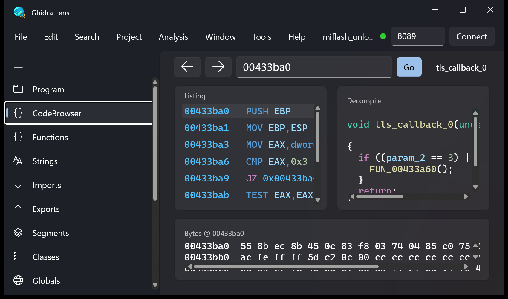

# Ghidra Lens

A modern [WinUI 3](https://learn.microsoft.com/windows/apps/winui/winui3/) front-end for
[Ghidra](https://ghidra-sre.org/). Ghidra stays the analysis engine; Ghidra Lens drives it through the
[GhidraMCP](https://github.com/bethington/ghidra-mcp) plugin's HTTP API — so you get a native, dark-mode,
TV-readable UI over the full Ghidra feature set without the Java Swing interface.

Ghidra Lens launches and manages Ghidra for you in the background. You run **one** app.



## Features

- **One-app workflow** — auto-starts Ghidra, hides its windows, restores your last project/program, and
  saves + stops Ghidra on exit. Toggle Ghidra's own windows back on any time from the Window menu.
- **Syntax highlighting** — C (decompiler), x86 disassembly, P-code and JSON, with clickable address
  links that jump straight to the CodeBrowser.
- **CodeBrowser** — synchronized listing, decompiler and hex view with back/forward navigation.
- **Functions workbench** — decompile, disassembly, xrefs to/from, callers, callees and variables;
  rename, comment, tag, set prototype and bookmark.
- **Live debugging** — Time (run control, registers, stack, breakpoints, traces) and Static Mappings
  (static ⇄ dynamic address translation across the ASLR slide), backed by Ghidra's dbgeng agent.
- **P-code Stepper** — step through a function's raw/refined P-code op by op, plus function emulation.
- **Lists** — Strings, Imports, Exports, Segments, Classes and Globals, each filterable, with xrefs.
- **All 239 tools** — every GhidraMCP endpoint, grouped by category, with forms generated from the
  plugin's live schema.

## Requirements

- Windows 10 19041+ / Windows 11, [.NET 10 SDK](https://dotnet.microsoft.com/download)
- Ghidra 12.1.x with the [GhidraMCP](https://github.com/bethington/ghidra-mcp) extension enabled
  (HTTP server on `127.0.0.1:8089`)
- For live debugging: a Python environment with Ghidra's `ghidradbg` / `ghidratrace` agent installed
  (point to it under **File → Settings**)

## Build

```powershell
dotnet build GhidraLens.csproj -c Release -p:Platform=x64
```

Output: `bin\x64\Release\net10.0-windows10.0.26100.0\win-x64\GhidraLens.exe` (unpackaged, self-contained).

## First run

1. Open **File → Settings** and set your Ghidra install folder (default `C:\Tools\RE\ghidra\ghidra_12.1.4_PUBLIC`).
2. Launch Ghidra Lens. It starts Ghidra, opens your last project, and connects.
3. Open a program from the **Program** page, or import a binary via **File → Import file**.

Settings are stored in `%LOCALAPPDATA%\GhidraLens\settings.json`; a crash log, if any, is written to
`%LOCALAPPDATA%\GhidraLens\crash.log`.

## Architecture

| Layer | File |
|---|---|
| HTTP client + schema model | `GhidraClient.cs` |
| Ghidra lifecycle / window hiding / session restore | `GhidraHost.cs` |
| Syntax highlighter (C / Asm / P-code / JSON) | `Highlighter.cs` |
| Shell, menus, dialogs | `MainWindow.xaml(.cs)` |
| Pages | `*Page.xaml(.cs)` |

## License

MIT. Ghidra is a product of the NSA, released under the Apache License 2.0. GhidraMCP is a separate
third-party project. Ghidra Lens is not affiliated with or endorsed by either.
